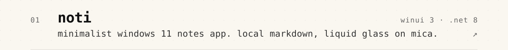
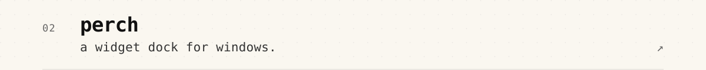
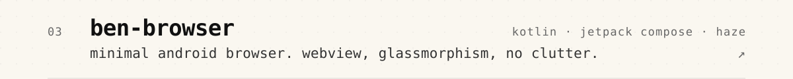
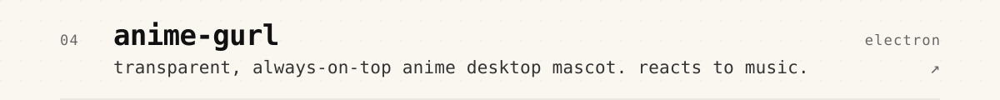
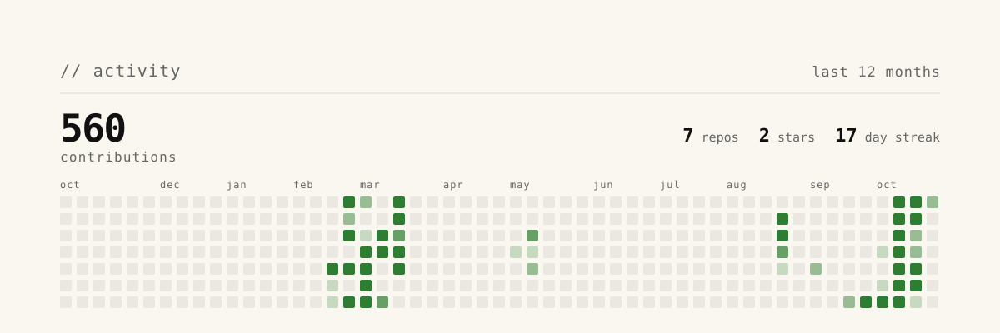
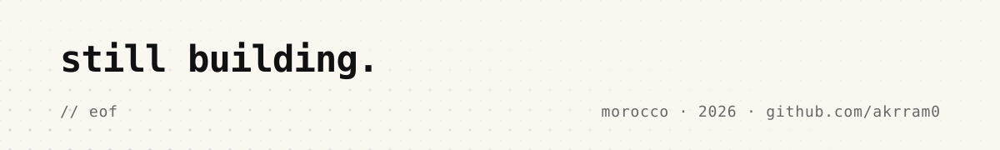

<picture>
  <source media="(prefers-color-scheme: dark)" srcset="assets/hero-dark.svg">
  
</picture>
<a href="https://github.com/akrram0/atlas-terminal">
<picture>
  <source media="(prefers-color-scheme: dark)" srcset="assets/now-dark.svg">
  
</picture>
</a>
<picture>
  <source media="(prefers-color-scheme: dark)" srcset="assets/label-work-dark.svg">
  
</picture>
<a href="https://github.com/akrram0/noti">
<picture>
  <source media="(prefers-color-scheme: dark)" srcset="assets/row-noti-dark.svg">
  
</picture>
</a>
<a href="https://github.com/akrram0/perch">
<picture>
  <source media="(prefers-color-scheme: dark)" srcset="assets/row-perch-dark.svg">
  
</picture>
</a>
<a href="https://github.com/akrram0/ben-browser">
<picture>
  <source media="(prefers-color-scheme: dark)" srcset="assets/row-ben-browser-dark.svg">
  
</picture>
</a>
<a href="https://github.com/akrram0/anime-gurl">
<picture>
  <source media="(prefers-color-scheme: dark)" srcset="assets/row-anime-gurl-dark.svg">
  
</picture>
</a>
<picture>
  <source media="(prefers-color-scheme: dark)" srcset="assets/stats-dark.svg">
  
</picture>
<picture>
  <source media="(prefers-color-scheme: dark)" srcset="assets/footer-dark.svg">
  
</picture>

